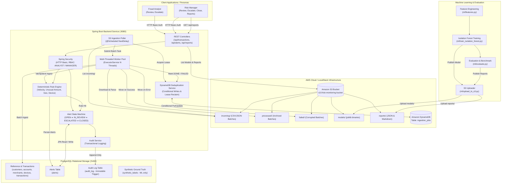

# Transaction Risk Monitoring & Alerting System

[](https://github.com/RathanPaida/risk-monitoring-system/actions)


An enterprise banking risk monitoring platform that ingests high-volume transactions (**100K+ records**), flags suspicious activity using both deterministic rules and an unsupervised machine learning model (Isolation Forest), routes alerts through a role-based review and escalation workflow supported by a database-enforced immutable audit trail, and features scalable scheduled batch ingestion from AWS S3 with distributed DynamoDB conditional write deduplication.

---

## Key Capabilities & Resume Highlights

| Capability | Implementation & Proof Point |
|---|---|
| **Spring Boot REST Service & PostgreSQL** | Robust REST API, Flyway migrations (`V1`-`V3`), OpenAPI / Swagger UI at `/swagger-ui.html` |
| **High-Volume Ingestion** | Generates and loads **105,000** realistic synthetic transactions over 90 days with 1,795 frauds across 5 patterns |
| **High-Performance Rule Engine** | 4 configurable fraud detection rules; replayed **105,000 transactions in 973 ms** generating **4,019 alerts** |
| **Scheduled S3 Ingestion & Worker Pool** | Multi-threaded `ExecutorService` poller consuming CSV/JSON transaction batches from `s3://.../incoming/` |
| **DynamoDB Distributed Deduplication** | Atomic `PutItem` with `attribute_not_exists(batch_key)` & expired lease reclamation preventing duplicate processing |
| **Cloud Model & Report Storage** | Versioned Isolation Forest models and evaluation reports stored in S3; Manager-only `GET /api/reports` API |
| **Stateful Alert Workflow** | Finite state machine (`OPEN` $\rightarrow$ `IN_REVIEW` $\rightarrow$ `ESCALATED` $\rightarrow$ `CLOSED_CONFIRMED` / `CLOSED_FALSE_POSITIVE`) |
| **Role-Based Access Control (RBAC)** | Strict privilege separation between `ANALYST` and `MANAGER` via Spring Security HTTP Basic & method security |
| **Immutable Audit Log** | PostgreSQL trigger prevents `UPDATE` and `DELETE` on audit log; verified by automated integration tests |
| **Unsupervised ML Anomaly Detection** | Isolation Forest model trained on time-based split with zero target leakage, benchmarked against rules |
| **High Test Coverage** | Java **83.9%** line coverage via JaCoCo; Python **93.1%** coverage via `pytest-cov` (≥80% enforced in build & CI) |
| **DevOps & CI/CD** | Multi-stage Docker build, Docker Compose with LocalStack & PostgreSQL, automated GitHub Actions CI pipeline |

---

## Architecture Diagram



---

## Tech Stack

- **Backend:** Java 17+, Spring Boot 3.2.5, Maven, Spring Web, Spring Data JPA, Spring Security, Flyway, Springdoc OpenAPI
- **AWS & Cloud:** AWS SDK v2, Amazon S3, Amazon DynamoDB, LocalStack
- **Database:** PostgreSQL 16+
- **Machine Learning & Data:** Python 3.10+, pandas, numpy, scikit-learn, Faker, boto3, psycopg2, matplotlib, pytest, pytest-cov
- **Testing:** JUnit 5, Mockito, Spring Boot Test, JaCoCo, pytest
- **DevOps:** Docker, Docker Compose, GitHub Actions CI

---

## Quick Start

### 1. Prerequisites
- Java 17 or higher
- Maven 3.9+
- Python 3.10+
- PostgreSQL 16+ (or Docker)
- Docker & Docker Compose (for LocalStack and containers)

### 2. Running with Docker Compose (Postgres, LocalStack & Backend)
```bash
docker compose up -d
```
Starts PostgreSQL, LocalStack (S3 & DynamoDB emulator), and the Spring Boot backend container.

### 3. Running Locally
```bash
# 1. Generate Synthetic Transactions (105,000 txns, 1.7% fraud)
python ml/generate_data.py

# 2. Run Python Generator, Feature & S3 Upload Tests
pytest ml/tests/ -v

# 3. Start Backend (runs Flyway migrations V1-V3 automatically)
cd backend
mvn clean spring-boot:run

# 4. Load Data into PostgreSQL (loads 105,000 txns & reference tables in ~8 seconds)
python ml/load_data.py --port 5433

# 5. Replay Historical Transactions through High-Performance Rule Engine
curl -u manager1:Manager123! -X POST http://localhost:8080/api/admin/replay
# Output: {"totalTransactions": 105000, "alertsGenerated": 4019, "executionTimeMs": 973}

# 6. Verify Database Record Counts
# SELECT count(*) FROM transactions;  --> 105,000
# SELECT count(*) FROM alerts;        --> 4,019
# SELECT count(*) FROM audit_log;     --> 4,019

# 7. Run Backend Integration & Security Tests (Verifies RBAC, State Machine & AWS Services)
cd backend
mvn verify
# Result: 93 tests passing, 83.9% line coverage enforced

# 8. Train ML Model and Upload Artifacts to S3
cd ..
python ml/train_isolation_forest.py
python ml/evaluate.py --port 5433
python ml/upload_to_s3.py

# 9. Query Manager Reports Endpoint
curl -u manager1:Manager123! http://localhost:8080/api/reports
```

### 4. Interactive Swagger UI
Access the interactive OpenAPI UI at:
`http://localhost:8080/swagger-ui.html`

Demo Credentials:
- **Analyst:** `analyst1` / `Analyst123!`
- **Manager:** `manager1` / `Manager123!`

---

## AWS Configuration & Real AWS Deployment

The system seamlessly switches between LocalStack (local development) and real AWS:

| Configuration Property | Environment Variable | Default / LocalStack | Real AWS Example |
|---|---|---|---|
| `aws.region` | `AWS_REGION` | `us-east-1` | `us-west-2` |
| `aws.endpoint` | `AWS_ENDPOINT` | `http://localhost:4566` | *(empty string for real AWS)* |
| `aws.s3.bucket-name` | `AWS_S3_BUCKET` | `risk-monitoring-bucket` | `my-prod-risk-bucket` |
| `aws.s3.worker-threads` | `AWS_S3_WORKER_THREADS` | `4` | `8` |
| `aws.dynamodb.table-name` | `AWS_DYNAMODB_TABLE` | `ingestion_jobs` | `ingestion_jobs` |
| `aws.dynamodb.lease-duration-seconds` | `AWS_DYNAMODB_LEASE_DURATION` | `300` | `300` |

---

## Machine Learning & Evaluation Benchmark

We benchmarked the **Deterministic 4-Rule Engine** against an **Unsupervised Isolation Forest** model and an **Ensemble Hybrid (Rules OR ML)** on an out-of-time test split of **24,150 transactions** (20.7 days, 399 ground-truth frauds):

| Detection Strategy | Precision | Recall | F1 Score | False Positive Rate (FPR) | Total Alerts | Alerts / Day |
|---|---|---|---|---|---|---|
| **Rules Only** | **33.38%** | 64.91% | **0.4409** | 2.18% | 776 | 37.4 |
| **Isolation Forest (ML)** | 27.05% | 40.60% | 0.3246 | **1.84%** | 599 | **28.9** |
| **Combined (Rules OR ML)** | 24.59% | **67.42%** | 0.3603 | 3.47% | 1,094 | 52.7 |

### Visualizations & Report
- **Metrics Comparison Plot:** `ml/reports/metrics_comparison.png`
- **Analyst Workload Trade-off Plot:** `ml/reports/workload_tradeoff.png`
- **In-Depth Technical Discussion:** See [ml/reports/evaluation.md](ml/reports/evaluation.md) for detailed analysis of trade-offs.

---

## Design Decisions & Trade-offs

1. **Dual Detection (Rules + ML):** Deterministic rules provide instantaneous, auditable, regulatory-compliant alerts with specific reason codes. The unsupervised Isolation Forest detects multi-dimensional anomalies where individual attributes do not breach static rule thresholds.
2. **Distributed Deduplication via DynamoDB Conditional Writes:** Processing files from S3 across multiple worker threads or container instances introduces race conditions. We use DynamoDB `PutItem` with `attribute_not_exists(batch_key)` for atomic distributed leasing, coupled with expired lease reclaiming to gracefully handle worker crashes without manual intervention.
3. **Multi-Threaded Worker Pool with Safe Partitioning:** A dedicated `ExecutorService` processes transaction batches in parallel while isolating errors so a malformed batch moves to `failed/` without aborting concurrent jobs.
4. **Database-Level Audit Immutability:** Rather than relying exclusively on application code, a PostgreSQL trigger (`V2__audit_immutable.sql`) rejects `UPDATE` and `DELETE` queries directly at the database engine level.
5. **Time-Based Train/Test Split:** Random K-fold cross validation causes temporal data leakage in fraud detection. We enforce a strict temporal cut (first 70 days train, subsequent 20.7 days test) ensuring models only learn from historical patterns.

---

## Known Limitations

1. **Synthetic Data:** Data is synthetically generated using Faker and distribution modeling. Real production distributions contain non-stationary drift and seasonality.
2. **Rule Thresholds:** Thresholds ($500 minimum, 5 txns/10 min, 10x mean) are illustrative defaults and should be tuned per risk appetite.
3. **Authentication:** Uses HTTP Basic Auth over HTTPS for simplicity. Production deployments should utilize OAuth2 / OIDC with JWT tokens and short lifetimes.

---

## Interview Talking Points

- **Why DynamoDB conditional writes for deduplication?** In cloud environments, two workers or auto-scaled containers could read the same S3 object simultaneously. An atomic `PutItem` with `attribute_not_exists(batch_key)` guarantees mutually exclusive batch ownership with single-digit millisecond latency.
- **How does the system handle crashed workers?** Each lease stores a `lease_expiry` timestamp. If a worker process terminates mid-batch, subsequent pollers detect `lease_expiry < now` and atomically re-claim the lease using a conditional `UpdateItem`.
- **Why both rules and ML?** Rules are explainable, auditable, and cheap; ML catches subtle multi-dimensional patterns no human wrote a rule for. The evaluation showed combining both boosted recall to 67.42%.
- **Why an out-of-time split?** In financial fraud, future information leaks backwards if random shuffling is used. A chronological cut mirrors real-world production deployment.
- **Why enforce audit immutability in SQL?** Application bugs, ORM misconfigurations, or compromised credentials cannot rewrite history when the database engine blocks updates.
- **Alert volume vs precision trade-off:** Lowering thresholds increases fraud capture but swells analyst fatigue (from 37 to 53 alerts/day). High-risk alerts should trigger auto-blocks while medium alerts enter human review.

---

## SDLC Documentation & Links

- [docs/demo-walkthrough.md](docs/demo-walkthrough.md): 2-minute step-by-step live demo script with curl commands
- [docs/requirements.md](docs/requirements.md): Functional and non-functional requirements
- [docs/user-stories.md](docs/user-stories.md): 10 user stories with acceptance criteria
- [docs/architecture.md](docs/architecture.md): Architecture diagrams and component specifications
- [docs/api.md](docs/api.md): REST API endpoints documentation
- [docs/sprint-board.md](docs/sprint-board.md): Complete sprint task tracking board
- [ml/reports/evaluation.md](ml/reports/evaluation.md): Machine learning evaluation report
