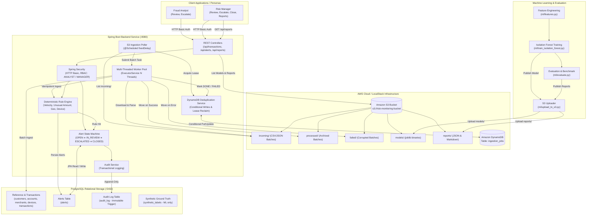

# Architecture & System Design

## 1. System Overview

The Transaction Risk Monitoring & Alerting System is architected as an enterprise-grade, high-throughput micro-platform comprising:
- A high-performance **Spring Boot 3 REST Backend** executing real-time rule evaluations, multi-threaded S3 ingestion, and stateful alert workflows.
- A **PostgreSQL 16/18** relational data store with composite indexes and a database-enforced immutable audit trigger.
- An **AWS Cloud Integration Layer** (S3 + DynamoDB) featuring scheduled batch ingestion, multi-threaded worker pools, and distributed conditional write deduplication.
- A **Python 3.10/3.11 Machine Learning Pipeline** for offline feature extraction, unsupervised anomaly detection (Isolation Forest), automated S3 artifact publication, and empirical benchmark reporting.
- **Client Personas** (Analyst and Manager) interacting with the system via authenticated REST endpoints and Swagger OpenAPI UI.

---

## 2. System Architecture Diagram

---

## 3. Component Details

### 3.1 Spring Boot REST Service & Security
- **Framework:** Spring Boot 3.2.5 on Java 17/25.
- **Security:** HTTP Basic authentication utilizing `users` table credentials hashed with BCrypt. Role-based method authorization using `@PreAuthorize("hasRole('ANALYST')")` and `@PreAuthorize("hasRole('MANAGER')")`.
- **Transaction Processing:** Ingestion endpoints validate incoming transactions, persist records, and trigger synchronous rule execution.
- **Rule Engine:** Runs 4 independent rule implementations via composite pattern:
  - `VelocityRule`: Trailing transaction count within time sliding window.
  - `UnusualAmountRule`: Amount vs trailing 30-day moving average.
  - `GeoMismatchRule`: Country difference from customer origin or 1-hour temporal hops.
  - `NewDeviceRule`: Device ID novel to account with high-value transactions.
- **Workflow State Machine:** Enforces strict alert transitions:
  - $OPEN \rightarrow IN\_REVIEW$
  - $IN\_REVIEW \rightarrow ESCALATED$
  - $IN\_REVIEW \rightarrow CLOSED\_CONFIRMED \mid CLOSED\_FALSE\_POSITIVE$
  - $ESCALATED \rightarrow CLOSED\_CONFIRMED \mid CLOSED\_FALSE\_POSITIVE$ (Manager only)

### 3.2 Database Layer & Immutability Trigger
- **Schema Management:** Automated Flyway migrations (`V1__schema.sql`, `V2__audit_immutable.sql`, `V3__seed_users.sql`).
- **Immutable Audit Trail:** PostgreSQL trigger `audit_log_immutable_trigger` executes `BEFORE UPDATE OR DELETE ON audit_log` and raises an uncatchable SQL `RAISE EXCEPTION`, guaranteeing regulatory immutability against both application errors and DBA tampering.

### 3.3 AWS S3 Scheduled Ingestion & Worker Pool
- **Scheduled Poller:** An `@Scheduled` background worker checks the configured S3 bucket prefix (`incoming/`) at configurable poll intervals (`aws.s3.poll-rate-ms`).
- **Fixed-Size Worker Pool:** An `ExecutorService` thread pool (default 4 threads) concurrently processes files. Per-task error handling ensures a corrupted batch file does not block other workers or crash the service.
- **Graceful Shutdown:** Implements `@PreDestroy` with timeout-bounded termination awaiting in-flight tasks.
- **Idempotent Ingestion:** Employs batch insertion with conflict resolution: `INSERT INTO transactions ... ON CONFLICT (id) DO NOTHING`.
- **File Lifecycle Management:** Upon successful batch processing, files are copied to `processed/` and deleted from `incoming/`. On error, files are moved to `failed/` for DLQ triage.

### 3.4 DynamoDB Conditional Write Deduplication
- **Distributed Locking:** Multiple container instances or concurrent threads coordinate via DynamoDB table `ingestion_jobs` with partition key `batch_key` (`s3_key:eTag`).
- **Conditional Lease Acquisition:** Workers issue a `PutItem` with `ConditionExpression: attribute_not_exists(batch_key)` and status `IN_PROGRESS` with lease expiration timestamp (`lease_expiry`).
- **Collision Avoidance:** If another worker holds the lease, DynamoDB returns `ConditionalCheckFailedException`, causing the worker to safely skip the file.
- **Crashed Worker Recovery:** Expired leases are atomically reclaimed using conditional update `attribute_exists(batch_key) AND #status = :in_prog AND #lease_expiry < :now`.
- **Terminal States:** On success, status transitions to `DONE` with record and alert counts. On failure, status transitions to `FAILED` with the error trace.

### 3.5 Model & Reports Storage in S3
- **Model Versioning:** `upload_to_s3.py` uploads the trained Isolation Forest binary to `s3://<bucket>/models/<timestamp>_isolation_forest.joblib` and `models/isolation_forest.joblib`.
- **Report Archival:** Evaluation summaries and plots are archived under `s3://<bucket>/reports/`.
- **Management Endpoint:** `GET /api/reports` is restricted to `ROLE_MANAGER` and returns all available cloud and local audit artifacts.
