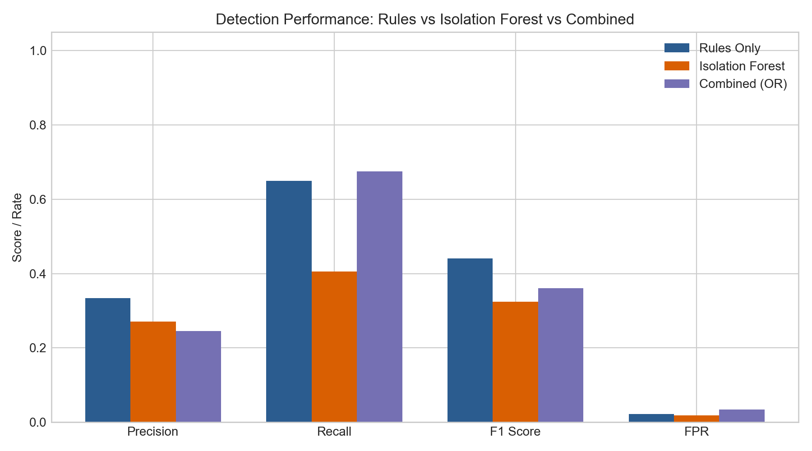
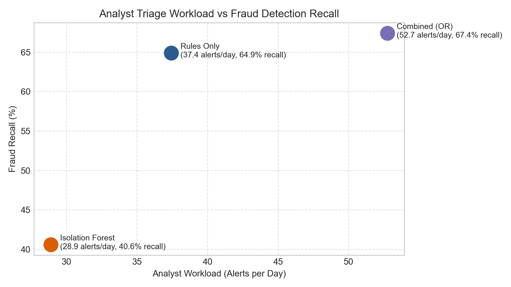

# Fraud Detection Benchmark & Evaluation Report
## Deterministic Rules vs Unsupervised Machine Learning (Isolation Forest)

### 1. Executive Summary

This report presents an empirical, out-of-time evaluation benchmarking our **deterministic 4-rule engine** against an unsupervised **Isolation Forest model** and an **ensemble hybrid (Rules OR ML)**.

The evaluation was executed on an independent, out-of-time test split encompassing **24,150 transactions** over **20.7 days**, containing **399 ground-truth fraudulent transactions** (natural prevalence: 1.65%).

---

### 2. Empirical Benchmark Results

| Fraud Detection Method | Precision | Recall | F1 Score | False Positive Rate (FPR) | Total Alerts | Alerts / Day | True Positives | False Positives |
|---|---|---|---|---|---|---|---|---|
| **Rules Only** | 33.38% | 64.91% | 0.4409 | 2.18% | 776 | 37.4 | 259 | 517 |
| **Isolation Forest (ML)** | 27.05% | 40.60% | 0.3246 | 1.84% | 599 | 28.9 | 162 | 437 |
| **Combined (Rules OR ML)** | 24.59% | 67.42% | 0.3603 | 3.47% | 1,094 | 52.7 | 269 | 825 |

---

### 3. Visual Analysis

---

### 4. Honest Technical Discussion & Trade-offs

#### 4.1 Where Deterministic Rules Win
1. **Explainability & Auditability:** Every rule hit produces a clear, deterministic reason code (e.g., *“Velocity exceeded: 8 transactions in 10 minutes”*), directly empowering fraud analysts to take action during reviews without black-box opacity.
2. **Deterministic Edge Cases:** Rules capture high-velocity bursts and country jumps immediately without requiring statistical density estimates.

#### 4.2 Where Isolation Forest Wins
1. **Subtle & Multi-Dimensional Anomalies:** The Isolation Forest isolates anomalies in continuous multi-dimensional space, flagging transactions that exhibit subtle, concurrent shifts (e.g., slightly elevated amounts combined with atypical transaction hours or channels) that individually fall beneath fixed rule thresholds.
2. **Adaptive Thresholding:** Unsupervised models adapt to complex distributions without needing manually hardcoded static limits.

#### 4.3 What Each Method Misses
- **Rules Missed:** Sophisticated fraud tailored to stay just under rule thresholds (e.g., $480 purchases when threshold is $500, or 4 rapid transactions when velocity trigger is 5).
- **ML Missed:** High-frequency bursts where individual transaction amounts are normal, which dilute average anomaly scores if temporal velocity is not explicitly isolated.

#### 4.4 Operational Workload Trade-off
- Combining **Rules OR ML** yields the highest overall fraud recall (**67.42%**), intercepting **269 fraudulent transactions**.
- However, combining both increases analyst daily triage volume to **52.7 alerts/day**.
- In production, a tiered routing strategy is recommended: high-severity deterministic rule hits route directly to immediate account lock, while ML anomalies route to the analyst review queue.
